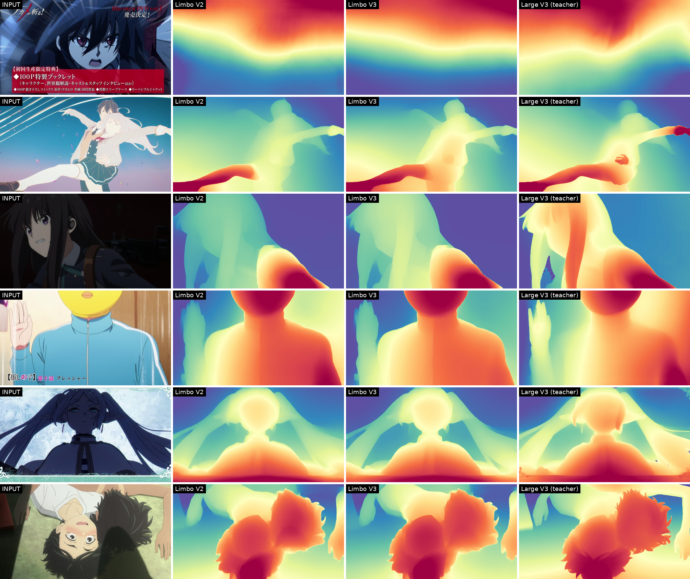

# Limbo-V3

Multi-frame TensorRT exports are available in [streaming/](streaming/): both precisions and resolutions. The independent-image export details below do not apply to those graphs.

**Anime monocular relative depth. 34.3 M parameters. Ready-to-run ONNX, opset 17. Drop-in replacement for Limbo-V2: same graph, same inputs and outputs, same speed.**



Original Arch: https://github.com/ByteDance-Seed/Depth-Anything-3
Original Arch License: Apache License 2.0

A fine-tune of [Limbo-V2](../Limbo-V2/), itself a fine-tune of
[`depth-anything/DA3-SMALL`](https://huggingface.co/depth-anything/DA3-SMALL) (Apache-2.0).
Limbo-V3 was trained by knowledge distillation from
[`depth-anything/DA3MONO-LARGE`](https://huggingface.co/depth-anything/DA3MONO-LARGE)
(Apache-2.0) on 165,432 anime frames, with three changes from Limbo-V2's recipe:

* **Multi-view teacher labels.** Each frame's target is the average of up to four teacher passes
  (original and mirrored, at 504 and 756 px). Where those passes disagree, a per-pixel confidence
  weight tells the student not to copy the teacher's noise.
* **Multi-resolution training** at 504, 756 and 1008 px, so the model holds up when run above its
  native grid.
* **Flip-consistency and smoothness terms**, which make the depth of a frame and of its mirror
  image agree, and keep flat-shaded regions flat.

The result is **steadier video depth**, with **12-22 % less flicker** than Limbo-V2 in
TheAnimeScripter's streaming pipeline, and cleaner object boundaries. Accuracy against the
teacher is unchanged. The published weights are a single training run (epoch 3 EMA): no averaging,
no soup.

The ONNX files need nothing but `onnxruntime`. No PyTorch, no `depth_anything_3`.

## Files

| file | dtype | batch | resolution | size | use it for |
| :-- | :-- | --: | :-- | --: | :-- |
| `Limbo_504x280_fp16.onnx` | fp16 | 1 | 504x280 (16:9) | 59.8 MiB | **default** for widescreen frames |
| `Limbo_504x280_fp32.onnx` | fp32 | 1 | 504x280 (16:9) | 95.8 MiB | reference precision, or runtimes without fp16 kernels |
| `Limbo_504x280_b4_fp16.onnx` | fp16 | 4 | 504x280 (16:9) | 49.3 MiB | video / batches - ~1.4x the throughput per frame |
| `Limbo_504x378_fp16.onnx` | fp16 | 1 | 504x378 (4:3) | 64.3 MiB | 4:3 sources (older TV anime) |
| `Limbo_504x378_fp32.onnx` | fp32 | 1 | 504x378 (4:3) | 95.8 MiB | 4:3, reference precision |
| `Limbo.safetensors` | fp16 | - | - | 65.5 MiB | the checkpoint, for re-export or further training |

SHA-256:

```
6a8f894f08fdb651036c3e6875bf357574b03003a4da2ae1ca9e82b66fc8534f  Limbo_504x280_fp32.onnx
19e1de53564bc1c84e47acbf98897e7ceb2db2e607661e3bf0997cd7272d7482  Limbo_504x280_fp16.onnx
cababd9f9957fef68dab17f6accd8f43b7a2140ac48d4c0dc79e4206fc2f3835  Limbo_504x280_b4_fp16.onnx
b0024e96618b43be88e0391f548d6b548bc3efdce5acfa5976caf25ac914bf80  Limbo_504x378_fp32.onnx
0b8c2f357b0430e5c7f05cab53710accf8955f8b1283d08d0eba2a7999460811  Limbo_504x378_fp16.onnx
8aa1dccf97bd7f1bca7d051ffa983dfe6faeed2356ba5eb9db63808d49f036f3  Limbo.safetensors
```

Every file carries its own license, upstream notice and provenance in its metadata header. For
the ONNX graphs that is `metadata_props`; for the checkpoint it is the safetensors header. The
terms survive being renamed or re-hosted:

```python
import onnx
print({p.key: p.value for p in onnx.load("Limbo_504x280_fp16.onnx", load_external_data=False).metadata_props})

from safetensors import safe_open
with safe_open("Limbo.safetensors", framework="pt") as f: print(f.metadata())
```

### The checkpoint

`Limbo.safetensors` is fp16, with 443 tensors and the same key set as Limbo-V2. Run provenance is
in its header. It is a plain state dict: loading it into a model needs the
[Depth Anything 3](https://github.com/ByteDance-Seed/Depth-Anything-3) code and the `DA3-SMALL`
`config.json`, with `strict=False` (`head.scratch.output_conv2_aux.*` differs from upstream by
design). `load_state_dict` casts it to your model's dtype. Anything that loads Limbo-V2's
checkpoint loads this one unchanged.

It is stored at fp16 rather than fp32 so it stays one file (GitHub refuses any blob over 100 MiB).
That costs nothing measurable. Re-scored on the frozen anime set, the fp16 checkpoint gives
`disp_mae` **0.45836**, against the fp32 original's **0.45838**.

### Download

```bash
curl -LO https://raw.githubusercontent.com/NevermindNilas/Ai-models/main/Limbo-V3/Limbo_504x280_fp16.onnx
```

## Quick start

```bash
pip install onnxruntime-directml numpy pillow   # Windows GPU (DirectML)
# pip install onnxruntime            # CPU only, any OS
# pip install onnxruntime-gpu        # CUDA / TensorRT
```

```python
import numpy as np, onnxruntime as ort
from PIL import Image

MEAN, STD = np.float32([0.485, 0.456, 0.406]), np.float32([0.229, 0.224, 0.225])

sess = ort.InferenceSession(
    "Limbo_504x280_fp16.onnx",
    providers=["DmlExecutionProvider", "CPUExecutionProvider"],  # or CUDA/TensorRT
)
print("EP:", sess.get_providers())     # only CPUExecutionProvider? you are on the slow path

inp = sess.get_inputs()[0]
_, _, H, W = inp.shape                 # 280, 504 - baked into the file
dt = np.float16 if "float16" in inp.type else np.float32

src = Image.open("frame.png").convert("RGB")
img = src.resize((W, H), Image.LANCZOS)          # LANCZOS: same filter the corpus was built with
x = ((np.asarray(img, np.float32) / 255.0 - MEAN) / STD).transpose(2, 0, 1)[None].astype(dt)

depth, conf = sess.run(["depth", "depth_conf"], {inp.name: x})   # (1,H,W) each

# depth is POSITIVE DEPTH. For the usual near-is-bright picture, invert it:
disp = 1.0 / np.clip(depth[0].astype(np.float32), 1e-6, None)
vis = (disp - disp.min()) / (disp.max() - disp.min())
Image.fromarray((vis * 255).astype(np.uint8)).resize(src.size, Image.BILINEAR).save("depth.png")
```

**Pick the file by aspect ratio.** 504x280 is 1.80 and 504x378 is 1.333. A plain `.resize()` to
a mismatched shape stretches the image, which costs accuracy. Centre-crop (or letterbox) to the
target ratio first:

```python
ar = W / H
sw, sh = src.size
if sw / sh > ar:                                  # too wide -> crop left/right
    new_w = int(round(sh * ar));  off = (sw - new_w) // 2
    src = src.crop((off, 0, off + new_w, sh))
else:                                             # too tall -> crop top/bottom
    new_h = int(round(sw / ar));  off = (sh - new_h) // 2
    src = src.crop((0, off, sw, off + new_h))
```

Letterboxed sources are the exception: crop the black bars off first, or the model spends its
depth range on them.

## I/O contract

| | name | shape | dtype | notes |
| :-- | :-- | :-- | :-- | :-- |
| input | `image` | `(B, 3, H, W)` | fp16 or fp32, matching the file | **ImageNet-normalised** RGB |
| output 0 | `depth` | `(B, H, W)` | same as input | **positive depth**, `exp` activation |
| output 1 | `depth_conf` | `(B, H, W)` | same as input | confidence, `exp(x) + 1` |

Two mistakes to avoid, both easy to make:

1. The input is **ImageNet-normalised**, not `[0,1]` and not BGR: `(rgb/255 - mean) / std`.
2. The output is **depth**, not disparity. Higher = further away. Invert it before applying the
   usual colour maps, or your depth map reads inside-out.

Relative depth only: the values carry no metric scale, and are comparable within one image, not
across images. Each batch slot is an independent image. The model's multi-view axis is fixed to
one view inside the graph, so batching cannot mix frames.

## What changed from Limbo-V2

All comparisons below use the same frames, preprocessing and resolution for both models. Every
change marked as a win is significant in a paired bootstrap (10,000 resamples, P > 0.975, most at
P = 1.000).

### Video stability

TheAnimeScripter streaming depth (16-frame windows, 50 % overlap) on a 22-second, 527-frame
promo clip. Flicker is scored only on "held" frame pairs, where the animation itself did not
change, so any change in depth there is pure flicker. Lower is steadier.

| TAS quality | Limbo-V2 | Limbo-V3 | change |
| :-- | --: | --: | --: |
| low (504x280) | 0.880 | 0.721 | **-18.0 %** |
| medium (longest side 700) | 0.781 | 0.684 | **-12.4 %** |
| high (native 1280x720) | 0.900 | 0.698 | **-22.4 %** |

The gain holds at every inference resolution, including above the training grid.

### Single frames (390-frame frozen anime set and boundary sets, at Limbo-V2's 504x280 grid)

| | Limbo-V2 | Limbo-V3 | change |
| :-- | --: | --: | --: |
| mirror consistency (`flip_mae` ↓) | 0.2104 | 0.1670 | **-20.6 %** |
| depth edges on image edges (`edge_agreement` ↑) | 0.3822 | 0.4005 | **+4.8 %** |
| flat-region noise (`flat_std` ↓) | 0.6200 | 0.6132 | **-1.1 %** |
| boundary lift, 400 human-drawn character mattes ↑ | 0.2014 | 0.2407 | **+19.5 %** |
| boundary lift, high-res matte set ↑ | 0.0576 | 0.0696 | **+20.9 %** |
| agreement with the teacher (`disp_mae` ↓) | 0.4599 | 0.4584 | -0.3 % (tie) |

At 644x1232 the margins grow: mirror consistency improves by **-52.8 %**, flat-region noise by
**-8.3 %** and edge agreement by **+17.6 %**. The boundary-lift metrics need no teacher. They
measure whether depth discontinuities land on hand-drawn character outlines and penalise maps
that put edges everywhere.

## Quality

The anime numbers are scored on a frozen anime evaluation set (390 held-out frames, 389 after
label QC). Forgetting is scored on the first 400 images of the NYUv2 test split, with real
Kinect ground truth. `disp_mae` is the primary metric: the mean absolute error of robust-normalised
disparity after per-image affine alignment. Lower is better.

| | anime `disp_mae` ↓ | anime AbsRel ↓ | anime δ1 ↑ | NYUv2 AbsRel ↓ | NYUv2 δ1 ↑ |
| :-- | --: | --: | --: | --: | --: |
| fp32 training checkpoint (reference) | 0.45838 | 0.24941 | 0.67716 | 0.12270 | 0.84965 |
| `Limbo.safetensors` (fp16) | 0.45836 | 0.24944 | 0.67727 | 0.12271 | 0.84963 |
| `Limbo_504x280_fp32.onnx` | 0.45874 | 0.24975 | 0.67640 | - | - |
| `Limbo_504x280_fp16.onnx` | 0.45870 | 0.24977 | 0.67634 | - | - |
| `Limbo_504x280_b4_fp16.onnx` | 0.45872 | - | - | - | - |
| `Limbo_504x378_fp32.onnx` | - | - | - | 0.12285 | 0.84933 |
| `Limbo_504x378_fp16.onnx` | - | - | - | 0.12284 | 0.84935 |

Every export lands within **0.1 %** of the reference on the primary metric, and within 0.15 % on NYUv2 AbsRel. fp16 costs nothing measurable. Measured through the onnxruntime CPU execution provider.

**Read the anime numbers honestly.** Anime has no ground-truth depth, so `disp_mae` measures
*agreement with the teacher that produced the training targets*. Limbo-V3 ties Limbo-V2 there
(0.45838 vs 0.45992). Its gains are on the teacher-free measurements above: mirror consistency,
flicker and boundary placement.

The NYUv2 columns use real ground truth and show what photographic ability was traded away.
NYUv2 AbsRel is tied with Limbo-V2 (0.1227 vs 0.1212). On 254 never-scored NYUv2 images, though,
Limbo-V3 is measurably worse: AbsRel 0.1127 vs 0.1054, δ1 0.8715 vs 0.8854. This stage trained on
anime only, with no photographic anchor. Limbo-V3 is an anime model. For photographs, Limbo-V2 or
upstream `DA3-SMALL` are the better choice.

## Performance

Same graph as Limbo-V2 (and Limbo-V1), so its measured latencies carry over directly; PyTorch GPU
latency of the checkpoint is identical to Limbo-V2's (14.29 vs 14.31 ms/frame, bs 1, fp16). RTX 3090,
onnxruntime 1.27 (DirectML build), 504x280, one session per process, median of 80 runs:

| | DirectML | CPU EP |
| :-- | --: | --: |
| fp32, batch 1 | 9.1 ms | 82 ms |
| fp16, batch 1 | **6.4 ms** | 92 ms |
| fp16, batch 4 (this file, IO-bound) | **4.6 ms/frame** (219 fps) | - |

For reference, the same model in eager PyTorch fp32 on the same GPU takes 14.5 ms. Opset 17 is
deliberate: every newer opset introduces an operator DirectML has no kernel for (`ScatterND`-18,
`Gelu`-20, `Attention`-23), which splits the graph and costs 3-16x. At opset 17 the whole network
runs as a single fused DirectML node.

## Constraints

* **Resolution is baked in.** There is one file per shape. Tracing freezes the backbone's
  positional-embedding interpolation, RoPE table and patch grid at the input shape. A
  dynamic-axis export errors out at the positional-embedding add rather than returning anything
  usable at another size. Resize to the file's exact `H x W`.
* Both sides must be multiples of 14 (the patch size). 504 is the longest-side resolution the
  upstream pipeline defaults to; the backbone's pretraining grid is 518x518.
* **Batch is static too**, for the same reason. Use the `b4` file for batches of 4.
* The graph is the monocular depth path only: the camera-pose branch and the auxiliary "ray" head
  are removed. `depth` is bit-identical to the full model's depth output.
* Trained on stylised animation. Not a metric depth model, not a photographic depth model, and
  not fit for anything safety-critical.

## Provenance

| | |
| :-- | :-- |
| base weights | [`depth-anything/DA3-SMALL`](https://huggingface.co/depth-anything/DA3-SMALL) - Apache-2.0 - fine-tuned via [Limbo-V2](../Limbo-V2/); its values are present in these files |
| initialisation | Limbo-V2 (NevermindNilas), whose training used a SUN397 photographic anchor |
| teacher | [`depth-anything/DA3MONO-LARGE`](https://huggingface.co/depth-anything/DA3MONO-LARGE) - Apache-2.0 - the only model used to make distillation targets; no non-commercial model involved |
| model code | [`ByteDance-Seed/Depth-Anything-3`](https://github.com/ByteDance-Seed/Depth-Anything-3) - Apache-2.0 - topology and exported op sequence |
| training data | 165,432 QC-passed anime frames: 14 broadcast series, plus scraped illustrations and background art. Episode-disjoint from every evaluation set, and near-duplicates of evaluation frames removed. Third-party images with no declared license (see LICENSE.MD section 3). No photographs in this stage |
| evaluation | frozen anime split with pseudo-label targets; NYUv2 test split (real ground truth) plus a never-scored 254-image holdout tail; CC0 anime alpha mattes for a teacher-free boundary metric; TheAnimeScripter streaming flicker on a held-frame promo clip |

No non-commercially-licensed model was involved in producing these weights. The training
*images* are a separate question: they are third-party copyrighted frames and illustrations
without a license, and no representation is made about them (LICENSE.MD section 3).

## License

**Dual.** [`LICENSE.MD`](LICENSE.MD) in this directory is the authoritative grant. In short:

* By default, **CC BY-NC 4.0**. The unmodified legal code is at the repository root,
  [`LICENSE.md`](../LICENSE.md).
* **Anyone using these weights through
  [TheAnimeScripter](https://github.com/NevermindNilas/TheAnimeScripter)**, users included, has
  a full commercial and closed-source grant, with no further permission needed.
* The upstream Depth Anything 3 material remains under **Apache-2.0**. A verbatim copy is in
  [`LICENSE-APACHE-2.0.MD`](LICENSE-APACHE-2.0.MD); the retained copyright notices and the
  statement of modifications are in section 4 of `LICENSE.MD`. Those notices travel with the files
  if you redistribute them. Simply running the model does not trigger anything.

Not affiliated with or endorsed by ByteDance, the Depth Anything authors, or Meta.

## Citation

If you use these weights, please also cite the upstream work they derive from:

```bibtex
@article{depthanything3,
  title={Depth Anything 3: Recovering the visual space from any views},
  author={Haotong Lin and Sili Chen and Jun Hao Liew and Donny Y. Chen and Zhenyu Li and Guang Shi and Jiashi Feng and Bingyi Kang},
  journal={arXiv preprint arXiv:2511.10647},
  year={2025}
}
```
